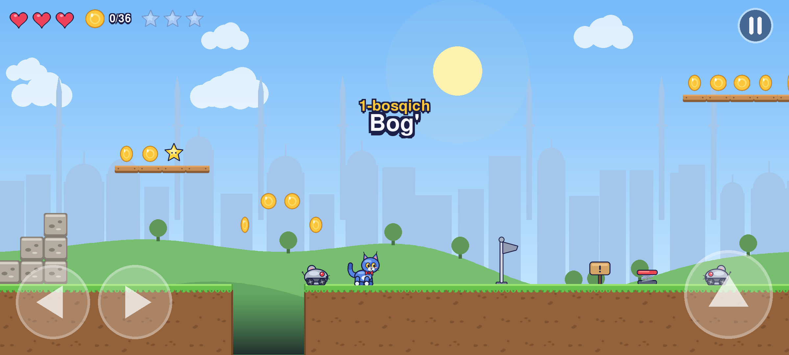
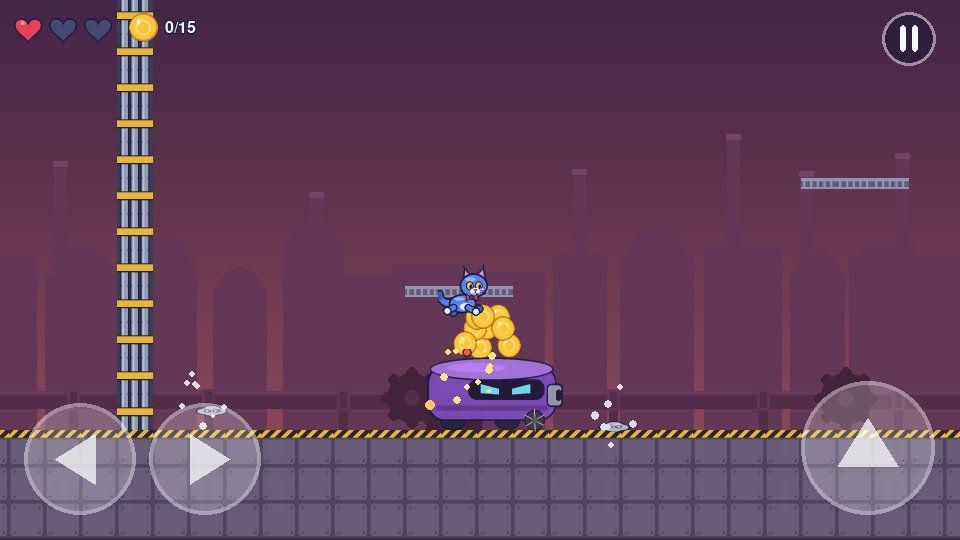
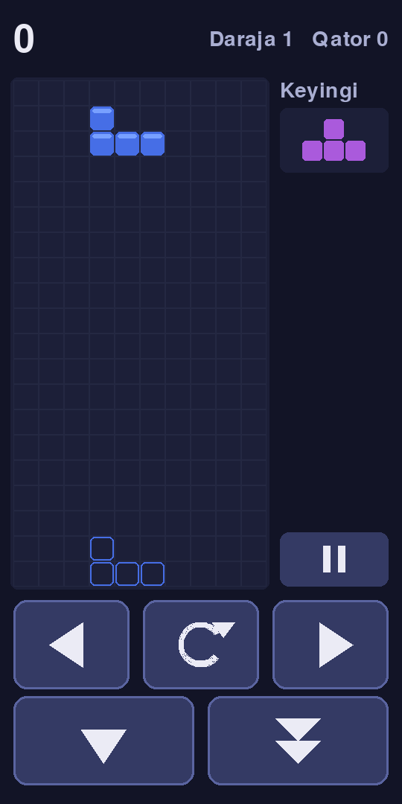

# Pydroid 3 uchun Python oʻyinlari

Ikkala oʻyin ham **pygame** kutubxonasida yozilgan. Pydroid 3 da u oldindan oʻrnatilgan.
Rasm va ovozni kodning oʻzi chizadi va yaratadi, tashqi fayl kerak emas.

## Ishga tushirish

1. `.py` faylni telefonga yuklab oling.
2. Pydroid 3 → menyu → **Open** → faylni tanlang.
3. Sariq **▶** tugmasini bosing.

Kompyuterda: `pip install pygame`, keyin `python pamuk_sarguzashti.py`.

## Pamukning sarguzashti — `pamuk_sarguzashti.py`

2D platformer: 6 bosqich (Bogʻ, Tomlar, Oʻrmon, Qorli togʻ, Fabrika va boss — Katta Changyutgich).

- **Boshqaruv:** ◄ ► — yurish, ▲ — sakrash (uzoqroq bossangiz balandroq), ॥ — pauza.
  Kompyuterda: ← → yoki A D, Probel / ↑ / W, Esc / P.
- Devorga tegib sakrash, prujina, harakatlanuvchi platformalar, qulaydigan bloklar, sirpanchiq muz.
- Dushmanlar: robot sichqon va ari (ustiga sakrab yengiladi), tipratikan (tikanli — chetlab oʻting).
- Har bosqichda tangalar va 3 ta yashirin yulduz; yurak; tekshiruv bayrogʻi.
- Natijalar fayl yonidagi `pamuk_saqlash.json` ga yoziladi.
- Telefonni yotqizib oʻynash qulayroq, tik holatda ham ishlaydi.

## Bloklar — `bloklar.py`

Tushayotgan bloklardan toʻliq qator yigʻish oʻyini.

- ◄ ► — surish, ⟳ — burish, ▼ — tezroq tushirish, ⏬ — darhol tashlash, ⏸ — pauza.
- Har 10 qatordan keyin daraja oshadi.

## Eslatma

Standart pygame shriftida oʻzbekcha «ʻ» harfi yoʻq, shuning uchun oʻyin ekranidagi
matnlarda oddiy «'» ishlatilgan (masalan, «O'yin tugadi»).
